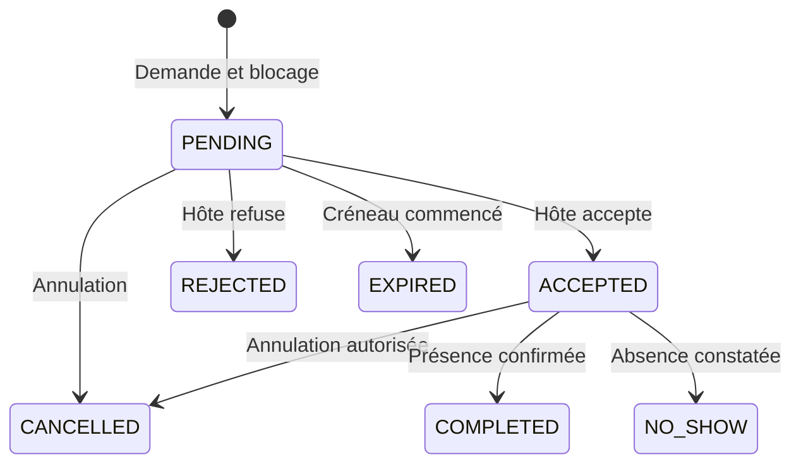
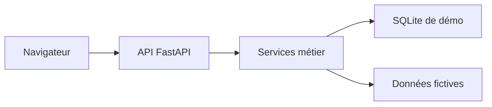

# BlablaCook — Référence complète pour les assistants IA du projet

**Document autonome d’équipe · Version 2.0 · 26 novembre 2026**  
**Projet étudiant · Hackathon de 36 h · Équipe de 4 · Nom provisoire : BlablaCook**

Ce fichier sert de cahier des charges fonctionnel, de contrat d’intégration et de contexte à joindre à tout nouveau fil avec un assistant IA. Le résumé, le plan, la version initiale du cahier des charges et les simulations restent consultables dans le [guide d’équipe BlablaCook](https://blablacook-hackathon.fuzzycrest1.chatgpt.site/).

## Sommaire

1. [Mission de l’assistant IA](#1-mission-de-lassistant-ia)
2. [Contexte et objectifs](#2-contexte-et-objectifs)
3. [Périmètre et décisions](#3-périmètre-et-décisions)
4. [Acteurs et visibilité](#4-acteurs-et-visibilité)
5. [Comptes, profils et sessions](#5-comptes-profils-et-sessions)
6. [Offres, recherche et carte](#6-offres-recherche-et-carte)
7. [Réservations et présence](#7-réservations-et-présence)
8. [Portefeuilles et crédits](#8-portefeuilles-et-crédits)
9. [Fonds solidaire](#9-fonds-solidaire)
10. [Messagerie et avis](#10-messagerie-et-avis)
11. [Écrans et parcours](#11-écrans-et-parcours)
12. [Environnement et architecture](#12-environnement-et-architecture)
13. [Modèle de données et transactions](#13-modèle-de-données-et-transactions)
14. [Contrat HTTP et JSON](#14-contrat-http-et-json)
15. [Vérification du logiciel](#15-vérification-du-logiciel)
16. [Organisation des 36 heures](#16-organisation-des-36-heures)
17. [Démonstration et simulations](#17-démonstration-et-simulations)
18. [Conventions à valider et passation](#18-conventions-à-valider-et-passation)

## 1. Mission de l’assistant IA

Avant de coder, identifier le lot confié par l’équipier, lire les instructions du dépôt, examiner les fichiers concernés et lancer les vérifications déjà disponibles. Distinguer **décisions actées**, **conventions de prototype** et **sujets reportés**. Le cahier des charges décrit le produit cible. Vérifier séparément ce qui existe dans le dépôt applicatif. La présence d’un écran sur le site d’équipe signifie que cet écran illustre le projet.

- Respecter les règles de gestion et les contrats partagés. Si une route, un DTO, un état ou un mouvement de crédits doit changer, signaler l’impact sur l’interface, l’API et les tests. Dès qu’un changement transversal est décidé, consigner la décision et mettre à jour ensemble le contrat, les constantes et les fixtures concernées.
- En cas de divergence, rechercher d’abord une décision d’équipe ultérieure. Pour une convention locale, poursuivre avec le choix le plus simple et compatible avec le dépôt, en l’annonçant. Demander un arbitrage si le choix modifie le périmètre, le parcours utilisateur, la confidentialité ou la comptabilité.
- Implémenter le plus petit changement complet pour le lot confié, en réutilisant les services existants. Les autorisations, la capacité, les états et les crédits se décident côté serveur. L’interface affiche les données renvoyées et traite les erreurs.
- Utiliser des comptes, adresses, positions et messages fictifs. Garder les vrais identifiants, accès et données personnelles hors du dépôt, des démonstrations et des fils IA.
- Terminer avec les fichiers modifiés, les scénarios testés, les commandes exécutées, les résultats et les points encore ouverts. Distinguer une vérification réellement exécutée d’une étape proposée.

**Message de départ à compléter par chaque équipier**

> Voici le contexte partagé de BlablaCook. Mon rôle est [A/B/C/D] et mon lot est [fonction et critères d’acceptation]. Le dépôt ou les fichiers sont [lien/chemin]. Nous en sommes à [jalon]. Lis le contrat concerné et l’état réel du dépôt. Si une décision d’équipe est nécessaire, indique précisément la divergence et son impact. Fais le travail demandé et vérifie le parcours concerné. Termine par les résultats et les commandes de vérification.

## 2. Contexte et objectifs

Des étudiants cuisinent régulièrement et disposent parfois de portions qu’ils pourraient partager. D’autres manquent de temps, de ressources, de matériel de cuisine ou de liens sociaux dans leur ville. BlablaCook met en relation des étudiants autour de repas faits maison. Un étudiant peut recevoir des invités un jour et être invité un autre jour. La fiche d’une offre présente le menu, le créneau, le secteur, l’hôte, les avis disponibles et les participants qui ont choisi d’être visibles. L’hôte décide quelles demandes il accepte.

Le projet se réclame d’une démarche collaborative, anticapitaliste et non marchande. **Les crédits sont des droits d’accès à des repas sur la plateforme.** Le tarif est commun à toutes les offres. Le transfert après participation reconnaît le fait d’avoir accueilli des invités et permet de réserver à son tour. Les dons volontaires permettent à des étudiants à solde nul de continuer à participer, y compris lorsqu’ils n’ont pas les moyens matériels de recevoir.

| Objectif | Ce que le prototype doit rendre visible |
| --- | --- |
| Créer des rencontres | Un étudiant trouve une table et contacte ou rejoint l’hôte. |
| Mutualiser un repas fait maison | Un hôte publie des places et décide des demandes reçues. |
| Faire circuler les crédits | Un crédit est réservé, puis versé à l’hôte après présence ou rendu à l’invité selon l’issue. |
| Élargir l’accès aux repas | Une personne à solde nul peut recevoir un crédit issu d’un don volontaire, en privé. |
| Comprendre les limites / l’équilibre offre-demande | Une simulation compare les mêmes besoins et capacités sous différents niveaux de dons. Avoir un crédit donne accès à une demande de réservation, sous réserve qu’une place soit proposée et acceptée. |

**Deux livrables distincts.** Le site d’équipe public existe déjà et sert de guide et de support de projection. L’application du hackathon est le produit P1/P2 à coder ou à intégrer dans le dépôt de l’équipe. Ses fonctions sont réservées aux étudiants vérifiés. Le public du guide et les utilisateurs de l’application correspondent à des droits différents. Le prototype vise une démo locale sur données fictives. Un lancement réel sur campus reste à décider.

## 3. Périmètre et décisions

| Statut | Contenu |
| --- | --- |
| **Acté** | Nom provisoire BlablaCook. Équipe de quatre. Objectif de livrer P1 et P2 en 36 h. Inscription étudiante. Trois crédits de bienvenue attribués une fois après vérification. Un crédit entier par place. Aucun solde négatif. Un hôte par repas. Fonds alimenté exclusivement par les dons volontaires. Les dons peuvent être encouragés via une invitation facultative. Aucune transaction en euros, aucun achat, aucune vente ni échange direct de crédits entre membres. |
| **P1** | Compte, vérification de l’adresse étudiante, session et profil minimal. Publication, recherche et fiche de repas. Demande, acceptation ou refus, annulation et expiration, puis confirmation de présence. Portefeuille, historique et invariant des crédits. |
| **P2** | Fonds solidaire et file d’attente, messagerie privée hôte–invité, avis réciproques après participation, carte des offres alignée sur les résultats de recherche. |
| **Convention du prototype** | Contrats et paramètres techniques ci-dessous, dont 90 min de durée par défaut, remboursement avant le début et en cas d’absence, 1 crédit par aide, 7 jours entre aides attribuées et au plus 3 sur 30 jours, 7 jours pour révéler un avis isolé. Utiliser ces valeurs tant que l’équipe ne les révise pas. |
| **Reporté** | Coorganisation, fractionnement, demande de repas par quartier, rapprochement algorithmique, justificatifs d’identité, traitement avancé des litiges et signalements, géocodage d’adresses réelles, application mobile native. |

La simulation d’une demande globale de repas appartient au site d’équipe. Dans l’application P1/P2, la recherche porte sur les repas publiés. Le mot « demande » dans les parcours désigne soit une **demande de réservation** pour une offre existante, soit une **demande d’aide** pour le fonds.

**Ordre souhaité.** Intégrer P1 jusqu’au versement d’un crédit avant de brancher P2. Dans P2, intégrer le fonds dès que les transactions P1 sont fiables. Les écrans carte, messagerie et avis peuvent avancer en parallèle sur les contrats convenus. Préserver les deux lots en réduisant la finition visuelle ou le nombre d’écrans en cas de retard.

## 4. Acteurs et visibilité

Les rôles hôte, invité, donateur et bénéficiaire sont des relations à une action. Une même personne peut tenir tous ces rôles avec son compte étudiant. Prévoir trois statuts d’accès : visiteur, compte étudiant en attente de vérification, compte étudiant vérifié. Un compte opérateur de démo peut préparer des données ou réinitialiser un environnement local. L’administration complète relève d’une phase ultérieure.

| Information ou action | Accès de référence |
| --- | --- |
| Guide d’équipe, démo interactive et simulation chiffrée du site | Toute personne ayant l’URL. Données fictives. |
| Inscription et vérification | Visiteur ou étudiant en attente selon l’action. |
| Catalogue, fiche, profil public étendu et avis publiés | Étudiant vérifié. |
| Adresse électronique et données privées du compte | Le titulaire. Les API de profil public omettent ces champs. |
| Pseudonyme, présentation et établissement | Pseudonyme et présentation de profil pour les étudiants vérifiés. Établissement visible selon le choix du titulaire. |
| Adresse du repas | Hôte et invité dont la réservation est à l’état ACCEPTED et le repas en cours d’organisation. L’adresse peut être lue jusqu’à la clôture de ce repas pour les invités encore confirmés. Elle disparaît après annulation ou lorsque la réservation devient terminale. |
| Position sur la carte et distance | Centre approximatif de secteur, calculé et servi par les mêmes règles que la liste. Aucune coordonnée privée dans l’API. |
| Participants sur la fiche | Uniquement les participants confirmés qui ont choisi d’être visibles. L’hôte voit la liste des demandes adressées à son repas même si les demandeurs ne sont pas visibles sur la fiche. |
| Portefeuille, historique, aide reçue et origine du crédit | Titulaire uniquement. L’hôte reçoit le montant et l’issue de sa réservation. |
| Solde global du fonds | Étudiants vérifiés. Affichage agrégé, en crédits entiers. |
| Fil et messages | Les deux membres du fil. |
| Avis soumis | Auteur pour son propre envoi. Les autres membres, dont le destinataire, y accèdent après publication. |

Construire des DTO à partir d’une liste de champs autorisés. La suppression d’un champ dans l’écran ne suffit pas s’il est encore présent dans une réponse réseau. Appliquer les droits à chaque lecture, liste, action et accès par identifiant.

## 5. Comptes, profils et sessions

- **CPT-01 · Inscription.** Saisir une adresse institutionnelle, un prénom d’usage ou pseudonyme et un mot de passe. Normaliser les espaces et la casse conformément à la règle de l’environnement, puis vérifier le domaine complet contre une liste configurée. En démo, la liste contient seulement des domaines fictifs convenus par l’équipe. La base garantit l’unicité de l’adresse normalisée.
- **CPT-02 · Vérification.** Envoyer un lien ou code en environnement réel. Démo : flux simulé clairement signalé, sur adresses fictives. Un compte en attente accède uniquement au parcours de vérification et à la sortie de session. Vérification réussie, création du portefeuille si nécessaire, émission de 3 crédits ordinaires et passage à VERIFIED dans la même transaction. Une nouvelle vérification du même compte ne crédite aucun montant supplémentaire.
- **CPT-03 · Connexion.** Identifier le compte par l’adresse normalisée et le mot de passe. Installer une session côté serveur. Les routes métier exigent VERIFIED. La déconnexion révoque la session, et le client efface ses vues sensibles en mémoire. Choisir une durée et les options du cookie au démarrage, selon les conditions locales et d’hébergement.
- **CPT-04 · Profil.** Autoriser le titulaire à changer pseudonyme, présentation, établissement affichable et consentement de visibilité des participations. Retirer la visibilité sur les fiches lorsque le consentement est révoqué. L’adresse email et les données d’authentification ne font pas partie de cette édition. Les notes affichées en P2 proviennent uniquement d’avis publiés.
- **CPT-05 · Comptes multiples.** L’unicité d’une adresse empêche deux comptes sur cette adresse. Une personne peut toutefois avoir plusieurs adresses. Aucun rapprochement automatique entre identités n’est prévu pendant le hackathon. L’octroi fréquent d’une aide constitue un indicateur d’usage, avec le même traitement que les autres demandes éligibles.

## 6. Offres, recherche et carte

| Champ | Saisie ou contrôle |
| --- | --- |
| Titre, description et menu | Obligatoires. Espaces extérieurs retirés, chaînes non vides. |
| Ingrédients | Liste obligatoire, non vide. Les informations restent déclaratives. |
| Information allergènes | Statut déclaré ou incertain. Associer les allergènes déclarés lorsqu’ils sont connus. Afficher distinctement une information incertaine, y compris dans les résultats filtrés. |
| Régimes compatibles | Liste éventuellement vide. L’écran affiche « aucun renseigné » si la liste est vide. |
| Début et fin | Début futur à la publication. Fin strictement après le début. Durée de 90 minutes par défaut si la fin n’est pas renseignée. |
| Capacité | Nombre entier strictement positif. Le prix est toujours 1 crédit par place et vient du serveur. |
| Secteur | Valeur publique sélectionnée dans un référentiel, avec centroïde approximatif. |
| Adresse exacte | Saisie obligatoire, privée. Utiliser une adresse fictive dans toute démo publique. |
| Photo | Facultative. La démo peut utiliser des ressources fournies dans les fixtures. |

- **REP-01 · Publication.** Un compte vérifié peut publier une offre dont il devient le seul hôte. Renvoyer l’identifiant, l’état PUBLISHED, les places disponibles et la fiche.
- **REP-02 · Recherche.** Rechercher les offres à venir par zone, date, disponibilité, régime et allergènes déclarés. Une zone de recherche peut être saisie ou obtenue par géolocalisation après une action de l’utilisateur. Afficher la liste par distance approximative quand une zone d’origine est connue, puis par créneau et identifiant pour obtenir un tri stable. Sans origine, trier par créneau puis identifiant.
- **REP-03 · Compatibilité alimentaire.** Un filtre par régime positif exige que le régime ait été déclaré pour le repas. Un filtre « exclure les offres déclarant cet allergène » repose sur les déclarations. Une information incertaine doit rester identifiée clairement si l’offre apparaît. Le texte « sans risque » n’est jamais dérivé d’une absence de déclaration.
- **REP-04 · Disponibilité.** Nombre de places confirmées = réservations ACCEPTED pour le repas. Pour un repas à venir ouvert, places restantes = capacité − demandes acceptées. Les PENDING ne consomment aucune place. Une annonce pleine peut rester consultable directement, avec demande désactivée. Les annonces passées, annulées ou complètes disparaissent du filtre « places disponibles ».
- **REP-05 · Modifier.** L’hôte corrige les informations mineures. Convention de prototype : pour un changement de date, d’adresse ou de menu, annuler l’offre et republier pour permettre une décision sur la nouvelle offre. La capacité peut être figée après publication en P1. Les personnes concernées retrouvent l’annulation et le remboursement dans leurs vues.
- **REP-06 · Annuler.** L’hôte annule une offre dont la clôture n’a pas été commencée. Dans la même transaction, les demandes PENDING et ACCEPTED passent à CANCELLED et leurs crédits sont libérés selon leur origine. Les demandes déjà terminales sont conservées. L’annulation ferme les nouvelles demandes et retire l’adresse côté invité.
- **REP-07 · Carte P2.** Liste et carte consomment le même résultat filtré, avec même pagination ou même liste bornée en démo. La carte affiche un point approximatif par secteur ou annonce, et ouvre la fiche correspondante. La liste reste utilisable en cas de refus de géolocalisation ou d’indisponibilité des tuiles. Pour la démo, utiliser les centroïdes fictifs et un fond fonctionnant localement ou un fond cartographique avec attribution.

## 7. Réservations et présence

**Le crédit bloqué appartient encore à l’invité.** L’acceptation donne accès à l’adresse et réserve une place. Le transfert vient seulement après confirmation de la présence. Une demande représente **une place pour le compte demandeur**.

| État avant | Acteur et condition | État après | Crédit et capacité |
| --- | --- | --- | --- |
| Aucune réservation active sur l’offre | Étudiant vérifié autre que l’hôte. Offre ouverte et future, au moins une place affichée et 1 crédit disponible. | PENDING | Déplacer 1 disponible vers 1 bloqué, même origine. Aucune place confirmée. |
| PENDING | Hôte, avant le début. Place disponible et aucun chevauchement avec une autre réservation ACCEPTED pour cet invité. | ACCEPTED | Une place confirmée. Le crédit reste bloqué. |
| PENDING | Hôte, avant le début. | REJECTED | Rendre le crédit de même origine. |
| PENDING | Horloge à l’heure de début ou après, sans acceptation préalable. | EXPIRED | Rendre le crédit de même origine. |
| PENDING / ACCEPTED | Invité, strictement avant le début, ou hôte annulant l’offre entière avant sa première clôture. | CANCELLED | Rendre le crédit et libérer une place si elle était acceptée. |
| ACCEPTED | Hôte, à la fin du repas ou après, et invité présent. | COMPLETED | Verser le crédit bloqué en crédit ordinaire à l’hôte. Autoriser un avis par partie en P2. |
| ACCEPTED | Hôte, à la fin du repas ou après, et invité absent. | NO_SHOW | Rendre le crédit de même origine selon la convention du prototype. |

- **RES-01 · Horaires.** Utiliser des intervalles `[starts_at, ends_at)`. A et B se chevauchent si `A.starts_at < B.ends_at && B.starts_at < A.ends_at`. Deux repas contigus passent le contrôle. À l’heure exacte de début, bloquer acceptation, demande et annulation par l’invité. À l’heure exacte de fin, la clôture devient possible côté hôte.
- **RES-02 · Capacité et doublons.** Un couple (invité, repas) a au plus une réservation active. Plusieurs demandes peuvent attendre pour la dernière place. Traiter chaque acceptation dans une transaction qui relit capacité, états et chevauchements avant écriture. Une tentative impossible laisse la demande PENDING afin que l’hôte puisse la refuser ou qu’elle expire. Après refus ou annulation, une nouvelle tentative avant le début reste possible si les préconditions sont remplies. Chaque tentative garde son historique.
- **RES-03 · Échec ou répétition.** Rejouer une action déjà effectuée ne crée aucun mouvement supplémentaire. Une répétition identique rend l’état canonique si identifiable. Une décision différente sur un état terminal produit INVALID_STATE. L’interface recharge l’offre, le portefeuille et les demandes après un conflit.
- **RES-04 · Expiration.** Prévoir un service qui traite les demandes PENDING arrivées à échéance. Pour une petite démo, on peut le joindre aux accès pertinents, y compris à la consultation du portefeuille et des réservations. Le service doit fonctionner même si la personne ouvre d’abord son portefeuille. Tester son résultat avec une horloge injectée et deux exécutions. Une seule expiration et une seule libération par demande.
- **RES-05 · Clôture de l’offre.** L’hôte clôture chaque invité accepté en présence ou absence après le repas. L’offre peut passer FINISHED après l’heure de fin lorsque ses réservations actives ont été traitées. Une réservation ACCEPTED reste visible à traiter tant que l’hôte n’a pas statué. Prévoir un indicateur de clôture à faire. Un versement automatique et une procédure formelle de litige relèvent d’une décision ultérieure. En démo, utiliser une horloge contrôlée par le scénario, sans route de contournement publique.
- **RES-06 · Notification.** P1 expose dans « Mes demandes » et « Mes repas » le dernier état, la date de mise à jour et le mouvement de crédit associé si l’utilisateur en est partie. La messagerie P2 ne tient pas lieu de preuve de réservation. La confirmation vient de l’état renvoyé par l’API.



## 8. Portefeuilles et crédits

Chaque portefeuille contient quatre compteurs entiers. Le journal donne la cause de chaque mouvement.

| Compteur | Usage |
| --- | --- |
| Ordinaire disponible | Réserver ou donner. |
| Solidaire disponible | Réserver uniquement. Prioritaire au moment du blocage si les deux origines sont disponibles. |
| Ordinaire bloqué | Crédit ordinaire attaché à une demande PENDING ou ACCEPTED. |
| Solidaire bloqué | Crédit solidaire attaché à une demande PENDING ou ACCEPTED. |

| Opération | Débit | Crédit | Montant |
| --- | --- | --- | --- |
| Prime de bienvenue | Source d’émission virtuelle | Disponible ordinaire de l’étudiant vérifié | 3 |
| Demande de repas | Disponible de l’invité, origine retenue | Bloqué de l’invité, même origine | 1 |
| Restitution | Bloqué de l’invité | Disponible de l’invité, même origine | 1 |
| Repas réalisé | Bloqué de l’invité | Disponible ordinaire de l’hôte | 1 |
| Don | Disponible ordinaire du donateur | Fonds | Entier positif demandé par le donateur |
| Aide attribuée | Fonds | Disponible solidaire du bénéficiaire | 1 |

**Invariant global**

```text
Somme des 4 compteurs de tous les portefeuilles + solde du fonds
    = 3 × nombre de comptes ayant reçu la prime de bienvenue
```

Ce calcul couvre les comptes avec solde zéro ou suspendus si l’état existe dans le dépôt. La source virtuelle d’émission ne compte pas dans la somme. Chaque écriture à partir d’une demande active est liée à son identifiant. Au niveau d’un étudiant, la somme des crédits bloqués de chaque origine égale le nombre de demandes PENDING ou ACCEPTED portant cette origine. Chaque compteur et le fonds restent supérieurs ou égaux à zéro. Une retenue, restitution, confirmation, aide ou donation n’émet aucun nouveau crédit. Les corrections futures, si autorisées, se font par un mouvement inverse audité.

**Exemple** : Lucas dispose de 3 crédits, Emma de 6, le fonds de 0. Lucas demande un repas : 2 disponibles et 1 bloqué. Emma accepte : mêmes soldes. Emma confirme la présence : Lucas reste à 2 disponibles et 0 bloqué, Emma passe à 7. Emma donne 1 : Emma revient à 6 et le fonds passe à 1. La masse totale reste 9 en comptant Sarah, dont le solde est nul au début du scénario.

## 9. Fonds solidaire

- **SOL-01 · Don.** Tout étudiant vérifié peut donner un nombre entier positif de crédits ordinaires disponibles, dans la limite de son solde au moment de l’écriture. Aucun prélèvement automatique, plafond d’accumulation ni montant minimum de solde imposé après le don. Une invitation facultative au don peut être affichée. Le seuil de 4 crédits utilisé dans la simulation décrit une hypothèse de comportement, distincte des règles de l’application.
- **SOL-02 · Aide automatique.** Un étudiant à zéro crédit **disponible** (ordinaire + solidaire) peut demander 1 crédit. Une demande active à la fois. Convention : au moins sept jours écoulés depuis la dernière attribution, avec moins de trois aides attribuées dans les 30 jours glissants. Les demandes annulées ou en attente ne décomptent aucune attribution. Compter les délais avec l’horloge du serveur. Choisir la borne [maintenant − 30 jours, maintenant] au lancement et partager les tests de bord.
- **SOL-03 · File.** Si la demande est éligible, la placer dans la file. Lorsque le fonds dispose d’au moins 1 crédit, servir par ordre `requested_at` puis identifiant. Recontrôler l’éligibilité juste avant l’écriture. Clore une demande devenue inéligible avec un motif privé et passer à la suivante. Une attribution change l’état et comptabilise le transfert dans la même transaction. Un don qui peut débloquer la file lance son traitement. Si le dépôt sépare don et traitement, le même mécanisme doit être rejouable et pouvoir reprendre après interruption.
- **SOL-04 · États.** WAITING : la demande attend d’être servie. GRANTED : exactement un crédit a été attribué. CANCELLED : la personne a fermé sa demande avant attribution. INELIGIBLE : une demande en attente a perdu son éligibilité entre la création et le traitement. Une demande initialement inéligible retourne une erreur sans rejoindre la file.
- **SOL-05 · Origine.** L’annulation, le refus, l’expiration et l’absence rendent le crédit solidaire à l’invité. Un repas réalisé transforme ce même crédit en crédit ordinaire pour l’hôte. La confidentialité est la même pour un bénéficiaire à première demande et à demandes répétées. Le profil ou la réservation ne révèle aucun motif d’aide.
- **SOL-06 · Don rejoué.** Utiliser une clé d’idempotence par intention de don, avec numéro de requête conservé par le client en cas de délai d’attente. Une même clé conserve la même réponse et le même effet. Si le montant change pour une clé existante, renvoyer un conflit. Un double clic, un rechargement ou un nouvel appel du processus de file ne crée aucune nouvelle attribution pour la même demande.

## 10. Messagerie et avis

### Messagerie P2

- **MSG-01 · Ouvrir un fil.** Un étudiant vérifié ouvre depuis une fiche un fil privé avec son hôte, avant même la réservation. Un fil par couple (offre, étudiant invité). Répéter l’ouverture renvoie le fil existant. L’hôte retrouve les fils dans sa boîte. Il peut répondre au contact qui les a ouverts.
- **MSG-02 · Écrire et lire.** Seuls les deux participants ont accès au fil. Texte simple de 1 à 2 000 caractères après retrait des espaces extérieurs. Enregistrer auteur, date et contenu. Afficher comme du texte et trier par (date, identifiant). Les pièces jointes, discussions entre invités et indicateurs de présence sont reportés.
- **MSG-03 · Gestion simple du fil.** La convention peut laisser le fil accessible aux mêmes membres après la réservation ou l’annulation, pour consulter et terminer leur échange. La messagerie n’altère aucun état de réservation et ne renvoie pas automatiquement l’adresse privée. Afficher l’échec d’envoi et conserver le brouillon pour pouvoir réessayer.

### Avis P2

- **AVI-01 · Éligibilité.** Une réservation COMPLETED autorise deux avis potentiels : l’invité vers l’hôte et l’hôte vers cet invité. Déduire le destinataire de la réservation. Un seul avis par couple (réservation, auteur). Note entière de 1 à 5. Commentaire facultatif, en texte simple. L’interface expose des retours utiles sur l’accueil et le respect des engagements.
- **AVI-02 · Publication.** Tant que les deux avis ne sont pas déposés et que sept jours ne se sont pas écoulés depuis `completed_at`, conserver le premier avis privé pour son auteur. À la seconde soumission dans le délai, publier les deux. À l’issue des sept jours, publier l’avis déjà déposé s’il existe. Convention de contrat : la soumission est ouverte avant la borne des sept jours. Après cette borne, le dépôt d’un nouvel avis est refusé. Un avis caché n’est inclus dans aucun calcul de moyenne ni décompte visible.
- **AVI-03 · Cas interdits.** Refuser avis en doublon, note hors bornes, acteur tiers, avis sur réservation annulée/refusée/expirée/absence ou non clôturée. La modification d’un avis soumis est reportée. Utiliser uniquement des textes fictifs dans la démo publique.

## 11. Écrans et parcours

| Écran | Éléments attendus | États à prévoir |
| --- | --- | --- |
| Inscription, connexion, vérification | Domaine accepté, instructions, vérification simulée en démo, connexion et déconnexion | Email non autorisé ou déjà inscrit, code expiré, vérification réussie, session expirée |
| Recherche | Zone, date, régime, disponibilité, mentions alimentaires, résultat et tri | Chargement, erreur récupérable, liste vide, repas complet |
| Fiche repas | Menu, créneau, secteur, profil d’hôte, places, coût, état de ma demande et adresse si autorisée | Adresse masquée, demande en attente, place confirmée, absence de crédit, repas annulé |
| Publier / gérer mes repas | Formulaire, mes offres, demandes reçues, acceptation ou refus, annulation, clôture de présence | Conflit de capacité, changements majeurs, confirmation de participants |
| Mes réservations | Demandes en cours et historique, état, dernier mouvement, annulation si permise | En attente, confirmée, refusée, expirée, annulée, repas réalisé, absence |
| Portefeuille | Disponibles et bloqués, distinction solidaire visible du titulaire, historique | Solde à zéro, crédits bloqués, activité vide |
| Fonds solidaire P2 | Solde global, don confirmé par une action explicite, demande privée, état de ma demande | Fonds vide, file d’attente, éligibilité, aide accordée, annulation, montant invalide |
| Messages P2 | Liste des fils, détails, texte et date, formulaire d’envoi | Fil vide, erreur, session expirée |
| Profil et avis P2 | Profil selon autorisations, liste des avis publiés, formulaire après COMPLETED | Aucun avis, avis soumis en attente, avis déjà envoyé, délai dépassé |
| Carte P2 | Points approximatifs et clic ouvrant la fiche, bascule vers liste | Aucun résultat, géolocalisation refusée, fond indisponible |

**Principes d’interface.** Concevoir d’abord le parcours mobile. Associer les libellés aux contrôles. Prévoir navigation clavier et focus visible. Accompagner chaque état d’un texte lisible. Éviter les doubles envois côté écran et garder une protection côté serveur. Pour toute écriture de crédit, montrer le résultat renvoyé par l’API, avec un message d’échec et un moyen de réessayer si nécessaire. Les soldes et les places sont actualisés après chaque action réussie ou conflit. L’interface traduit les valeurs des états, tandis que le code d’API conserve les valeurs du contrat.

## 12. Environnement et architecture

Les technologies ci-dessous reprennent le choix de travail proposé pour le hackathon. À H0–H2, regarder le dépôt, confirmer les versions communes et conserver toute décision existante compatible. Le matériel exact, l’hébergeur de l’application P1/P2 et les versions de dépendances sont à confirmer par l’équipe.

| Couche | Référence de travail |
| --- | --- |
| Interface | HTML/CSS/JavaScript, responsive, ressources locales pour la démo. Feuille de style partagée et composants simples. |
| API | Python 3, FastAPI, Pydantic, réponses JSON et OpenAPI. |
| Persistance locale | SQLAlchemy avec SQLite. Schéma et données reproductibles. SQLite sur fichier pour les scénarios d’intégration et de concurrence. |
| Persistance de pilote | PostgreSQL à envisager si besoin d’accès concurrents et de déploiement multi-utilisateur. |
| Géographie P2 | Leaflet ou composant déjà disponible, secteurs fictifs, distances à vol d’oiseau. |
| Tests | Pytest pour services et API. Une recette navigateur ou un script de bout en bout pour le scénario principal. |
| Collaboration | Dépôt Git partagé, branche de démo stable et intégrations courtes. Le site public du guide a son propre cycle de publication. |
| Démarrage | README commun, installation des dépendances et commandes réellement disponibles, script de peuplement déterministe. En local, servir interface et API sous une même origine si possible. |



**Découpage indicatif**

```text
backend/
  main.py                   Démarrage et enregistrement des routes
  config.py                 Paramètres et environnement
  database.py               Session SQL et transactions
  models/                   Tables et contraintes
  schemas/                  Corps, réponses et erreurs
  routers/                  Auth, comptes, repas, réservations, wallet, solidarité
  services/                 Règles de gestion, transactions et horloge
  tests/                    Unitaire et intégration
frontend/
  assets/                   Style, composants et images locales
  pages/                    Recherche, offre, gestion hôte, portefeuille, fonds
scripts/
  seed_demo.py              Données et scénario reproductibles
.env.example                Exemples non secrets
README.md                   Commandes, mode démo, tests, dépannage
```

**Convention d’environnement à adopter si le dépôt ne l’a pas déjà fixée.** Distinguer démo et déploiement réel. Paramétrer la connexion à la base, les domaines autorisés, l’origine de l’interface, la clé de session, et les constantes de durée (repas, aides, avis). Prévoir une horloge injectable dans les services. Éviter un mode démo qui permette de vérifier n’importe quelle adresse réelle ou de modifier l’heure d’une application publique. Le dépôt versionne une configuration d’exemple dépourvue de secrets. Un membre doit pouvoir recréer la base locale et démarrer le parcours principal en suivant le README.

**Règles de confidentialité et de disponibilité de la démo.** Hacher les mots de passe avec une bibliothèque adaptée, gérer les sessions et leurs cookies selon l’environnement, contrôler les écritures authentifiées et vérifier les autorisations par ressource. Définir et tester une protection CSRF si l’authentification utilise des cookies. Utiliser des requêtes paramétrées. Rendre le texte utilisateur comme du texte. Garder les secrets, adresses, tokens et messages hors des journaux généraux. Prévoir une base de secours peuplée et une carte fonctionnelle avec données locales. Pour étendre le prototype à de vrais étudiants, décider séparément de la modération, de la gestion des incidents, des données conservées, de la population autorisée et du support.

## 13. Modèle de données et transactions

### Entités et contraintes

Les champs structurants ci-dessous sont une référence de contrat. Réutiliser le schéma existant lorsqu’il représente les mêmes règles. Une migration commune accompagne les changements d’état ou de contrainte.

| Table | Champs principaux | Contraintes / points d’accès |
| --- | --- | --- |
| `users` | id, normalized_email, password_hash, status, display_name, bio, school, show_school, show_as_participant, verified_at, created_at | Email unique. Un compte peut héberger et réserver. |
| `email_verifications`, `sessions` | user_id, empreinte du jeton, échéance, consommation/révocation, dates | Jetons à usage défini et durée bornée. Tables privées, réservées au service d’authentification. |
| `wallets` | user_id, ordinary_available, solidarity_available, ordinary_locked, solidarity_locked | Clé unique par user_id, états entiers et non négatifs. |
| `meals` | id, host_id, title, menu, description, ingredients, allergens_status, allergens, diets, starts_at, ends_at, capacity, zone_id, private_address, state, dates de création et modification | FK hôte et secteur. Capacité entière > 0, fin > début. Prix dérivé = 1. Index sur secteur et début. Sérialisation privée conditionnelle. |
| `zones` | id, label, latitude et longitude approximatives | Liste configurée. Aucun champ d’adresse privée. |
| `bookings` | id, meal_id, guest_id, status, funding_origin, requested_at, accepted_at, completed_at, updated_at | FK repas et invité. Unicité des lignes actives par couple. Index sur repas/état et invité/état. Origine immuable pour cette tentative. |
| `ledger` | id, operation_key, kind, source, destination, amount, booking_id ou solidarity_request_id, created_at | Clé d’opération unique et montant entier > 0. Écriture seule. Les types de comptes distinguent émission, ordinaire, solidaire, bloqué et fonds. |
| `solidarity_fund` | id fixe, balance | Une seule ligne, solde entier ≥ 0. |
| `solidarity_requests` | id, user_id, status, requested_at, granted_at, updated_at, private_reason | Une demande WAITING par utilisateur. Index pour la file et l’historique par utilisateur/date d’attribution. |
| `conversations`, `messages` | fil : id, meal_id, guest_id, host_id, created_at. Message : id, conversation_id, sender_id, body, created_at | Un fil par couple repas/invité. Membres déduits du fil. Index chronologique des messages. |
| `reviews` | id, booking_id, author_id, subject_id, rating, body, created_at | Unicité (booking_id, author_id). Note entière 1–5. Date de publication dérivée ou synchronisée. |

**États et origines partagés.** Compte : PENDING_VERIFICATION, VERIFIED. Offre : PUBLISHED, CANCELLED, FINISHED. Réservation : PENDING, ACCEPTED, REJECTED, EXPIRED, CANCELLED, COMPLETED, NO_SHOW. Origine : ORDINARY ou SOLIDARITY. Demande d’aide : WAITING, GRANTED, CANCELLED, INELIGIBLE. Séparer l’état stocké d’une offre et sa capacité temporelle à recevoir une demande. Une offre PUBLISHED après son début peut être en cours ou attendre sa clôture.

### Stratégie transactionnelle

1. À la frontière du service, identifier le compte authentifié, valider la forme de la requête et récupérer l’heure serveur. Démarrer la transaction qui protège les ressources à modifier.
2. Relire les données critiques dans la transaction : états, horaires, capacité, conflits de réservation, éligibilité, solde ou clé d’idempotence. Décider sur ces données.
3. Écrire dans la même transaction les changements d’état, les variations de compteurs et les mouvements du journal concernés. Pour annuler un repas, appliquer l’ensemble des restitutions. Pour attribuer une aide, écrire ensemble GRANTED, le débit du fonds, le crédit de l’étudiant et la ligne du journal.
4. Valider. En cas d’erreur, annuler toutes les écritures de l’opération. Renvoyer la réponse canonique. Actualiser l’affichage à partir de ce résultat.
5. Prévoir le désaccord sous concurrence : deux demandes et un crédit, deux acceptations et une place, deux repas concurrents pour le même invité, dons qui consomment le même solde et aides qui consomment le même fonds. En SQLite, utiliser une stratégie de sérialisation des écritures avec transactions courtes. Si l’équipe utilise PostgreSQL, verrouiller les lignes dont dépend la décision de façon cohérente, notamment repas, portefeuilles et fonds selon l’opération. Tester avec deux sessions réelles et indépendantes.

**Clés d’opération types** : `signup:<user_id>`, `hold:<booking_id>`, `release:<booking_id>`, `complete:<booking_id>`, `grant:<request_id>`, `donate:<user_id>:<idempotency_key>`. Conserver la réponse des opérations rejouables ou la reconstruire à partir de l’état canonique. Pour une action liée à un état, l’unicité de la clé accompagne la vérification de transition. Elle ne remplace pas les contrôles d’autorisation ou de solde.

**Temps, pagination et typage.** Horodatages en UTC dans la base, formats ISO 8601 avec zone dans l’API et affichage local dans l’interface. Valider les entrées numériques comme entiers lorsque le contrat l’exige. Les comparaisons d’état et les calculs de crédits utilisent des entiers. Une pagination stable avec `limit` et `offset` suffit aux petites listes si le dépôt n’a pas déjà adopté des curseurs.

## 14. Contrat HTTP et JSON

Ce contrat développe les routes du cahier initial et propose les champs d’échange manquants. Partager un exemple JSON réel ou un export OpenAPI à H2. Les JSON ci-dessous sont des exemples d’accord frontend/backend. Adapter le format des identifiants à celui que l’équipe fixe, et le conserver dans tous les DTO. Les routes sont indiquées sans préfixe. Si un préfixe d’API est choisi, le documenter une seule fois dans le client.

| Lot | Méthode et route | Entrée principale | Sortie et droit |
| --- | --- | --- | --- |
| P1 | POST `/auth/register` | `email`, `password`, `display_name` | 201, compte en attente. Visiteur. |
| P1 | POST `/auth/verify-email` | `token` | 200, compte vérifié, émission idempotente. |
| P1 | POST `/auth/login` | `email`, `password` | 200, session et statut de vérification. |
| P1 | POST `/auth/logout` | Aucun corps | 204, session révoquée si présente. |
| P1 | GET, PATCH `/users/me` | PATCH : `display_name`, `bio`, `school`, `show_school`, `show_as_participant` | 200, profil du titulaire. |
| P1 | GET `/users/{id}` | Identifiant | 200, profil public selon visibilité. Étudiant vérifié. |
| P1 | GET `/meals` | `zone_id`, `radius_km`, `from`, `to`, `diet`, `exclude_allergen`, `available_only`, pagination | 200, liste filtrée. Étudiant vérifié. |
| P1 | POST `/meals` | Titre, menu, description, ingrédients, allergènes, régimes, créneau, capacité, `zone_id`, `private_address`, photo si prévue | 201, fiche créée. Étudiant vérifié. |
| P1 | GET `/meals/{id}` | Identifiant | 200, fiche selon droits. Étudiant vérifié. |
| P1 | PATCH `/meals/{id}` | Champs mineurs autorisés | 200, fiche mise à jour. Hôte. |
| P1 | POST `/meals/{id}/cancel` | Aucun corps nécessaire | 200, offre annulée. Hôte. |
| P1 | POST `/meals/{id}/bookings` | Aucun corps métier. Éventuelle clé de requête. | 201, PENDING. Invité vérifié. |
| P1 | GET `/bookings/me` | Pagination | 200, demandes et historique du titulaire. |
| P1 | GET `/meals/{id}/bookings` | Pagination | 200, demandes reçues. Hôte. |
| P1 | POST `/bookings/{id}/accept` | Aucun corps | 200, ACCEPTED. Hôte. |
| P1 | POST `/bookings/{id}/reject` | Aucun corps | 200, REJECTED. Hôte. |
| P1 | POST `/bookings/{id}/cancel` | Aucun corps | 200, CANCELLED. Invité, avant début. |
| P1 | POST `/bookings/{id}/complete` | `{ "attended": true }` ou `false` | 200, COMPLETED ou NO_SHOW selon présence. Hôte, à partir de la fin. |
| P1 | GET `/wallet` | Aucun corps | 200, soldes du titulaire. |
| P1 | GET `/wallet/transactions` | Pagination | 200, mouvements concernant le titulaire. |
| P2 | GET `/solidarity/fund` | Aucun corps | 200, solde global. Étudiant vérifié. |
| P2 | POST `/solidarity/donate` | `{ "amount": 1 }`, en-tête `Idempotency-Key` | 201, résultat du don. Donateur. |
| P2 | POST `/solidarity/requests` | Aucun montant à saisir | 201, demande WAITING ou GRANTED. Bénéficiaire. |
| P2 | GET `/solidarity/requests/me` | Pagination | 200, demandes privées du titulaire. |
| P2 | POST `/solidarity/requests/{id}/cancel` | Aucun corps | 200, demande CANCELLED si WAITING. Titulaire. |
| P2 | POST `/conversations` | `{ "meal_id": "meal_01" }` | 201 si créé, 200 si existant. Étudiant vérifié autre que l’hôte. |
| P2 | GET `/conversations/me` | Pagination | 200, fils du titulaire. |
| P2 | GET, POST `/conversations/{id}/messages` | POST : `body` | 200 ou 201. Membres du fil. |
| P2 | POST `/bookings/{id}/reviews` | `rating`, `body` facultatif | 201, état de publication de l’avis de l’auteur. Partie d’une réservation COMPLETED. |
| P2 | GET `/users/{id}/reviews` | Pagination | 200, avis déjà publiés. Étudiant vérifié. |

Pour les listes, convention proposée : `{ "items": [], "limit": 20, "offset": 0, "total": 0 }`. `total` peut être omis uniformément si l’équipe choisit des curseurs. Pour les écritures sans corps, garder la même règle dans le client et la documentation. Le coût du repas, l’identité de l’hôte, le destinataire de l’avis et l’origine du crédit se déduisent côté serveur.

**Exemple · Une offre filtrée, avant réservation**

```json
{
  "id": "meal_01",
  "title": "Pâtes aux tomates rôties",
  "starts_at": "2026-11-27T18:30:00Z",
  "ends_at": "2026-11-27T20:00:00Z",
  "host": { "id": "user_emma", "display_name": "Emma" },
  "zone": { "id": "zone_centre", "label": "Campus centre", "lat": 48.11, "lon": -1.68 },
  "capacity": 2,
  "available_seats": 2,
  "credit_cost": 1,
  "allergens_status": "DECLARED",
  "allergens": ["gluten", "lait"],
  "diets": ["vegetarien"],
  "state": "PUBLISHED"
}
```

La fiche peut ajouter `menu`, `description`, `ingredients`, `participants` consentants et `my_booking`. Ajouter `private_address` seulement lorsque l’utilisateur a le droit de la lire. Après acceptation d’une place, `available_seats` devient 1. Les réponses de recherche et de carte restent approximatives même pour un utilisateur confirmé.

**Exemple · Demande PENDING telle que la voit l’hôte**

```json
{
  "id": "booking_01",
  "meal_id": "meal_01",
  "guest": { "id": "user_lucas", "display_name": "Lucas" },
  "status": "PENDING",
  "requested_at": "2026-11-27T15:00:00Z",
  "updated_at": "2026-11-27T15:00:00Z"
}
```

L’origine du crédit figure, si nécessaire, dans le DTO privé de l’invité ou dans son historique, jamais dans le DTO de l’hôte. Les ressources dépendant de la session, en particulier fiche avec adresse, portefeuille, demandes et messages privés, évitent une mise en cache partagée.

**Exemple · Portefeuille privé de Lucas après la demande**

```json
{
  "ordinary_available": 2,
  "ordinary_locked": 1,
  "solidarity_available": 0,
  "solidarity_locked": 0
}
```

**Exemple · Crédit insuffisant**

```json
{
  "code": "INSUFFICIENT_CREDITS",
  "message": "Il faut 1 crédit disponible pour demander une place."
}
```

| HTTP | Cas représentatifs | Codes réutilisables |
| --- | --- | --- |
| 400 ou 422 selon la convention FastAPI | JSON, type, valeur ou paramètre invalide | VALIDATION_ERROR, INVALID_DONATION |
| 401 | Session absente, expirée ou identifiants invalides | AUTH_REQUIRED, INVALID_CREDENTIALS |
| 403 | Compte en attente ou action interdite sur une ressource connue et visible | ACCOUNT_NOT_VERIFIED, FORBIDDEN, OWN_MEAL_BOOKING |
| 404 | Identifiant absent ou ressource privée à masquer au demandeur | NOT_FOUND |
| 409 | Solde insuffisant, dernière place prise, conflit d’horaires, état incompatible, une demande d’aide active, quota, réemploi d’une clé avec un autre corps | INSUFFICIENT_CREDITS, MEAL_FULL, BOOKING_CONFLICT, INVALID_STATE, AID_LIMIT, AID_ALREADY_PENDING, IDEMPOTENCY_CONFLICT |
| 422 | Domaine hors liste ou créneau invalide | STUDENT_DOMAIN_NOT_ALLOWED, INVALID_TIMES |

Choisir des messages côté interface à partir de `code`. Afficher un message générique si le code est inconnu. Les réponses d’erreur évitent de véhiculer des données d’un compte tiers. Une tentative de don valide en forme mais supérieure au solde échoue en 409. Les erreurs de forme restent à 422 si l’équipe garde la convention FastAPI.

## 15. Vérification du logiciel

### Tests d’acceptation

| ID | Situation | Résultat attendu |
| --- | --- | --- |
| T01 · Compte | Inscrire une adresse autorisée, vérifier deux fois et se reconnecter | Compte vérifié, une seule émission de 3 crédits. Une autre adresse du même domaine reste soumise au même contrôle d’unicité. |
| T02 · Validation | Envoyer une adresse hors liste, un doublon normalisé et un token invalide | Erreur explicite. Aucun accès métier indu, aucune émission supplémentaire. |
| T03 · Publication | Publier avec date passée, capacité 0, capacité décimale, ou absence d’information allergènes | Rejet des entrées invalides. Cas valide à 1 crédit et au bon secteur. |
| T04 · Blocage | Lucas réserve avec 3 crédits, puis répète la demande | 2 disponibles, 1 bloqué, 1 demande active. Au plus une ligne HOLD pour cette demande. |
| T05 · Droits et solde | Tiers tente une action d’hôte. Hôte tente de réserver sa propre offre. Étudiant à zéro tente de réserver. | Actions refusées. Aucun changement de solde, d’état ou de capacité. |
| T06 · Refus | Hôte refuse puis répète son action | Crédit disponible de même origine, demande REJECTED, restitution unique. |
| T07 · Annulation invité | Invité annule avec réservation PENDING, puis autre cas ACCEPTED | Restitution unique, place libérée dans le second cas, adresse retirée. Annulation après le début refusée. |
| T08 · Annulation hôte | Offre avec demandes PENDING et ACCEPTED, dont une solidaire | Annulation atomique, toutes les lignes actives en CANCELLED et restitutions selon leur origine. |
| T09 · Expiration | Avancer l’horloge jusqu’au début avec une demande PENDING et ouvrir d’abord le portefeuille | EXPIRED, 1 disponible de plus. Répéter ne crée aucun mouvement. |
| T10 · Dernière place | Deux acceptations simultanées pour une place restante, via sessions indépendantes | Une seule ACCEPTED. L’autre demande reste PENDING avec erreur MEAL_FULL. |
| T11 · Temps | Essayer deux acceptations qui se chevauchent pour le même invité, puis essayer deux créneaux contigus | Une seule des acceptations concurrentes se chevauchant réussit. Les créneaux contigus sont acceptables. |
| T12 · Double dépense | Un étudiant avec un crédit demande simultanément deux offres | Une seule demande active créée. Aucun solde négatif. |
| T13 · Présence | Essayer une clôture avant fin, puis à la fin et répéter. Tester aussi le cas absent | Avant fin : refus. Présent : un seul transfert vers l’hôte. Absent : restitution avec origine préservée. |
| T14 · Confidentialité | Comparer réponses liste, fiche, carte, vue hôte, vue invitée confirmée et tiers | Adresse exacte uniquement pour les personnes autorisées. Aide et origine absentes des vues publiques et de la vue hôte. |
| T15 · Don | Don valide, dédoublonnage par clé, clé réemployée avec montant différent, puis montant supérieur au disponible ou solidaire seul | Un transfert unique pour une même intention. Conflit ou validation pour les autres cas. Fonds et soldes jamais négatifs. |
| T16 · Aide | Fonds vide → WAITING → don → GRANTED puis réservation | Débit et crédit symétriques. La file suit l’ordre d’arrivée éligible. Aucun double service. |
| T17 · Quotas et file | Vérifier à 6 j 23 h puis à 7 j, tester le plafond glissant, l’annulation et la perte d’éligibilité avant traitement | Résultat conforme aux seuils. Les demandes annulées ne décomptent rien. Les inéligibles n’absorbent aucun crédit. |
| T18 · Messagerie | Ouvrir deux fois le fil, envoyer comme membre, tenter lecture et écriture comme tiers | Fil unique. Seuls les deux membres ont accès. Taille/texte validés. |
| T19 · Avis | Soumettre un avis après COMPLETED, vérifier l’état privé, soumettre la contrepartie, puis tester le délai de sept jours | Publication commune ou après délai, sans décompte des avis cachés. Refuser doublons et demandes inéligibles. |
| T20 · Carte | Appliquer les mêmes filtres en liste et sur la carte, refuser la géolocalisation | Même ensemble d’offres, position approximative, saisie manuelle utilisable. |
| T21 · Invariants | Recalculer masse totale et retenues après chaque opération. Simuler une erreur pendant une écriture | Conservation, zéro compte négatif, aucune mise à jour partielle. |
| T22 · Recette | Remettre à zéro la démo et parcourir P1 puis P2 dans un navigateur | Parcours visible et reproductible avec les comptes et les indications du guide. |

### Stratégie

- **Unitaire** : compatibilité des horaires, calcul de distance approximative si retenu, éligibilité, validations, transitions autorisées, dates limites.
- **Intégration** : API, droits, base persistante, contraintes SQL, mouvements du journal, répétitions d’appels, exécution concurrente. Pour les cas en concurrence, utiliser une base SQLite sur fichier et deux connexions/sessions indépendantes. Paramétrer l’horloge sans attendre réellement.
- **Recette** : démarrer sur une base peuplée, jouer réservation et don, afficher l’historique, contrôler avis et carte, puis refaire le scénario. Tester l’absence d’adresse et d’origine dans le JSON, même si elles sont masquées à l’écran.
- **Critère d’intégration** : un équipier extérieur au lot lance sa branche ou sa version déployée, reproduit un scénario d’acceptation, puis confirme les résultats attendus. Enregistrer les commandes qui ont servi.

## 16. Organisation des 36 heures

| Équipier | P1 | P2 | Premier résultat à partager |
| --- | --- | --- | --- |
| A · Interface | Inscription, liste, fiche, publication, gestion hôte, portefeuille | Écrans fonds et messagerie, avis, intégration de la carte avec D | Maquette légère des écrans, états, exemples JSON attendus |
| B · API | Comptes, sessions, profils, repas, recherche, orchestration des réservations | Routes conversations, messages et avis | OpenAPI, permissions, DTO communs, intégration avec services de C |
| C · Crédits et solidarité | Portefeuille, journal, émission, blocage, libération, règlement | Dons, aides et file transactionnelle | Signatures des services, clés d’opération, tests invariants |
| D · Intégration et démo | Peuplement, tests de parcours, environnement commun et recette | Carte en appui de A, simulateur, scénario de présentation | Identifiants fictifs, horloge de recette, procédure de lancement |

### Jalons et dépendances

| Horaire relatif | Résultat attendu |
| --- | --- |
| H0–H2 | Répartition nominative, lancement du dépôt, confirmation du schéma, des états, des exemples JSON et de l’horloge de démo. Chaque équipier sait ce qu’il fournit et consomme. |
| H2–H12 | Chaque écran P1 possède un exemple. Première intégration authentification → catalogue → fiche → création de demande. Les opérations de crédits critiques ont des tests isolés. |
| H12–H18 | P1 intégré de bout en bout. Réserver, accepter, finir et vérifier les soldes. Tester refus, annulation, unicité et confidentialité. |
| H18–H28 | Intégrer le fonds et la demande d’aide. Brancher messagerie, avis et carte, puis rejouer P1 et P2 avec le même jeu de données. |
| H28–H34 | Recette croisée, corrections, vérification mobile, données de secours, version de démo et répétition. |
| H34–H36 | Geler les changements risqués, relancer la recette rapide, présenter. Ajuster les pauses et horaires au programme du hackathon. |

**Intégration continue à l’échelle de l’équipe.** S’accorder sur un dossier d’exemples de réponses ou un OpenAPI exploitable. Intégrer par petites unités et conserver une branche stable pour la démo. B et C s’accordent sur la frontière des transactions avant de connecter la réservation. A et D testent avec les fixtures communes. Si une fonctionnalité P2 se décale, garder le parcours crédits stable et réduire le travail d’interface au flux minimum testable.

## 17. Démonstration et simulations

### Distinction entre trois usages

| Usage | Rôle |
| --- | --- |
| Démo interactive du site d’équipe | Se projeter dans l’expérience avec Lucas, Emma et Sarah. Le navigateur manipule des états fictifs. La démo illustre la réservation, le portefeuille et la solidarité. |
| Simulation chiffrée du site d’équipe | Explorer l’équilibre entre offres, besoins et crédits. Elle compare des hypothèses sur plusieurs semaines et sert à préparer une discussion avec le jury. |
| Application du hackathon | Exécuter les parcours P1 et P2 avec les données fictives, via une vraie API et une base locale ou hébergée prévue pour le hackathon. |

### Jeu de données et scénario jury

Définir des comptes de démo clairement nommés. Si l’on veut repartir de l’état du site, initialiser l’historique à partir d’une prime de 3 par compte et de trois repas passés de Sarah chez Emma. Cela justifie Lucas 3, Emma 6 et Sarah 0, fonds 0, sans créer de crédits supplémentaires. Les montants sont ci-dessous des soldes disponibles. Garder des adresses, domaines d’exemple, textes et coordonnées fictifs ou volontairement approximatifs.

| Étape | Action | Résultat |
| --- | --- | --- |
| 0 | Remettre à zéro le scénario de démo. Emma propose « Pâtes aux tomates rôties », puis une seconde offre « Curry de pois chiches ». | Lucas 3, Emma 6, Sarah 0, fonds 0, total 9. |
| 1 | Lucas demande une place sur l’offre de pâtes. | Lucas 2, plus 1 bloqué. Adresse indisponible pour Lucas au stade PENDING. |
| 2 | Emma accepte Lucas. | La place est réservée. Lucas voit l’adresse. 1 crédit reste bloqué. |
| 3 | Avancer l’horloge de recette à la fin. Emma confirme Lucas présent. | Lucas 2, bloqué 0. Emma 7. Avis possible de chaque côté. |
| 4 | Emma donne 1 crédit. | Emma 6, fonds 1. |
| 5 | Sarah demande une aide, puis demande une place sur le curry. | Fonds 0, Sarah reçoit 1 crédit solidaire, puis 1 solidaire bloqué. Emma voit une demande de réservation, sans indication sur le crédit solidaire. |
| 6 | Selon le temps, revenir à Sarah et annuler avant le repas, ou faire accepter puis valider la présence. | Annulation : Sarah retrouve 1 solidaire. Présence : Emma gagne 1 ordinaire. Dans les deux cas, total 9. |

**Variantes de recette.** Demander l’aide avant le don pour montrer WAITING, puis pousser un don pour constater GRANTED. Ajouter un étudiant dans une fixture secondaire pour tester la dernière place. Montrer un message avant réservation, la réciprocité des avis et une recherche sur carte qui conserve les filtres. Utiliser une horloge locale injectée avec le second repas après le premier et éviter de décaler une démo en production via un mécanisme public.

### Simulation chiffrée déjà disponible dans le guide

Le site propose des paramètres pour le nombre d’étudiants, le nombre de semaines, la part sans cuisine, la fréquence des hôtes, la probabilité de don et la graine. Il compare **crédits seuls** et **crédits + dons**, avec le même tirage d’équipement, de besoins, d’hôtes et d’ordre de passage. Par défaut, le formulaire affiche 200 étudiants, 8 semaines, 35 % sans cuisine, 34 % d’hôtes potentiels actifs chaque semaine parmi les équipés, 30 % de probabilité de don parmi les personnes éligibles dans le modèle et une graine de 2026.

- Les étudiants ont trois crédits au départ. Le modèle tire un besoin hebdomadaire avec une probabilité de 70 %. Les hôtes de la semaine sont exclus de la demande de cette semaine et proposent chacun trois places. Les invités potentiels passent dans un ordre aléatoire reproductible.
- Dans le scénario solidaire, un étudiant disposant d’au moins quatre crédits ordinaires peut, selon la probabilité choisie, en donner un en début de semaine. Un étudiant à zéro peut obtenir un crédit du fonds et l’utiliser pour un repas lorsque des places restent, dans la limite des attributions retenues sur 30 jours. Le transfert de l’invité arrivé à l’hôte est comptabilisé à la fin de la semaine. La simulation modélise des repas hebdomadaires, avec une aide au plus par semaine et trois sur 30 jours.
- Le modèle suit les places proposées, demandes, repas obtenus, personnes sans cuisine servies, dons, aides utilisées et solde du fonds. L’indicateur de refus faute de crédit compte les demandes écartées alors qu’une place reste libre. Demandes servies = repas obtenus ÷ demandes, places occupées = repas obtenus ÷ places proposées, et taux sans cuisine = repas obtenus par les étudiants sans cuisine ÷ demandes de ce groupe. Renvoyer une valeur non définie si le dénominateur vaut zéro.
- À graine identique et dons à 0 %, les scénarios coïncident. À offre nulle, aucun repas n’est obtenu. Les crédits distribués plus le solde restant égalent les dons dans le modèle. Vérifier ces propriétés si le simulateur évolue.
- Les résultats dépendent des hypothèses. Le modèle suppose une capacité constante par hôte, simplifie l’affectation et la file d’attente, et ne représente ni les déplacements ni les préférences individuelles. Les résultats sont des projections sur données fictives, à présenter comme telles. Même abondamment doté, le fonds ne crée aucune nouvelle place.

## 18. Conventions à valider et passation

| Point | Valeur de travail, sauf décision d’équipe plus récente |
| --- | --- |
| Temps du repas | 90 min par défaut, fin modifiable avant publication. Expiration à l’heure de début et clôture possible à l’heure de fin. |
| Annulation et absence | Restitution intégrale avant début ou en cas d’absence. Annulation de l’offre par son hôte avant la première clôture. |
| Solidarité | 1 crédit par aide, solde disponible nul, 7 jours entre aides, plafond de 3 en 30 jours, file FIFO parmi les personnes toujours éligibles. |
| Avis | Publication réciproque ou après 7 jours, et soumission dans la même fenêtre de sept jours. |
| Visibilité | Participants visibles sur consentement. Adresse limitée à l’hôte et aux invités ACCEPTED. Origine du crédit visible du titulaire. |
| Environnement | Confirmer versions, règles de session, domaines fictifs, formats des identifiants, méthode de lancement et site de démo de l’application à H0–H2. |
| Clôture oubliée ou litige réel | Le prototype rend la réservation à traiter visible à l’hôte. Fixer une procédure et des garanties avant un pilote réel. |
| Après le hackathon | Confirmer la ville ou le campus de départ, les conditions d’accès réelles, la vérification des étudiants, la modération et le support en cas d’incident. |

**À renseigner dans le dépôt ou le fil d’équipe au démarrage**

- Dépôt et branche de référence, responsables A/B/C/D, versions du runtime et commandes exactes.
- Contrat API retenu, schéma/migrations, paramètres retenus et décisions qui s’écartent de cette version.
- Jeux de données et heure de début de recette, étapes de remise à zéro, emplacement et droits de la démo.
- Pour chaque PR ou passation : fonctionnalité couverte, fichiers modifiés, effets visibles, vérifications lancées, résultat attendu pour l’intégration et dépendances encore ouvertes.
